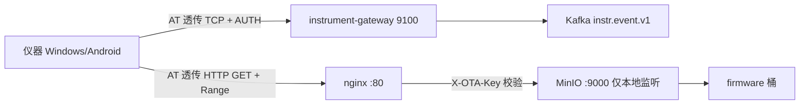
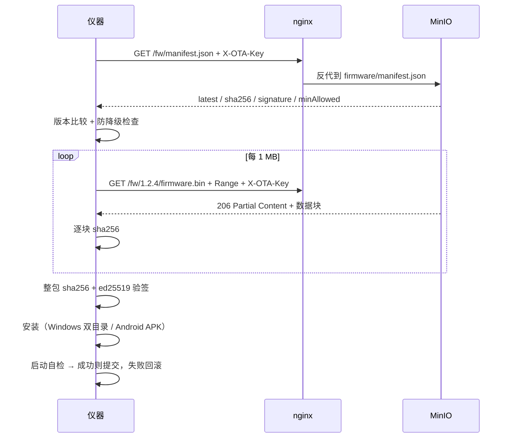

# 4G 链路与远程升级（OTA）方案决策记录

> 状态：Draft（待评审）
> 最后更新：2026-11-05
> 适用范围：仪器侧 4G 接入链路 + 固件远程升级
> 关联代码：instrument-gateway（TCP 9100 接入、AUTH 握手、分片重组）

---

## 1. 背景与约束

### 1.1 现状

```
仪器主控（MCU / Windows / Android）──UART── DX-CT511（Cat.1）──4G── instrument-gateway:9100 ── Kafka
```

| 项 | 现状 |
|---|---|
| 模组 | 大夏龙雀 DX-CT511 / DX-CT511N，UART 115200 |
| 单帧上限 | 1024 B（含 2 字节长度头），超出按 `msgId/seq/total` 分片 |
| 发送方式 | `AT+QISEND` 逐包，每包等 `SEND OK` |
| 实测吞吐 | 约 5~10 KB/s；10 MB 固件需 17~33 分钟 |
| 网关 | Netty 9100，首帧 AUTH、认证后业务帧无需 token |
| 升级方式 | 无（L0：人工上门） |

### 1.2 六个约束

| # | 约束 | 来源 |
|---|---|---|
| C1 | 数据面慢，OTA 不可行 | 逐包 AT 往返主导耗时 |
| C2 | 芯片/模组单次发送上限 1024 B | 硬件 |
| C3 | **不能让医院看到「设备在联网」** | 客户体验 / 合规 |
| C4 | 仪器多为 **Windows / Android**，有 **USB-A Host 口（蓝色 3.0）** | 现场设备形态 |
| C5 | 网关目前**单向**：只有设备→服务器，无下行通道 | 代码现状 |
| C6 | 设备散落各医院，**证书过期无法上门处理** | 运维现实 |

---

## 2. 决策记录（ADR）

### ADR-1：传输载体采用「现成工业 USB dongle」，不自研载板

| | 内容 |
|---|---|
| **决策** | 采购带 AT 口的工业级 USB 4G dongle（EC25 方案优先），插入仪器 USB-A Host 口 |
| **备选 A** | 自研 EC25 载板（LGA 焊接） |
| **备选 B** | 4G CPE / MiFi（网线或 WiFi 接入） |
| **选择理由** | ① 零硬件改动，1~2 天可验证；② 量 < 1000 台时 dongle 综合成本（设计+认证+返修）更低；③ 可先拿真实数字再决定 |
| **放弃 A 的原因** | 需要完整射频 + 电源设计（VBAT 3.8V/2A、90Ω 差分、50Ω 天线、SIM ESD），周期 4~8 周，且单套成本只省 50 元 |
| **放弃 B 的原因** | 多一个外置盒子，暴露面更大；天线、供电要额外管理 |
| **前置条件** | dongle 必须：暴露 AT 口、可关闭网卡（`AT+QCFG="usbnet",0`）、有外置天线口、无 LED 或可关 |

### ADR-2：只启用 AT 口，关闭模组网卡接口

| | 内容 |
|---|---|
| **决策** | 模组配置为**不启用 ECM/RNDIS 网卡**，系统里只出现虚拟串口（COMx / ttyUSBx） |
| **背景** | 实测过消费级 USB 上网卡：插入即显示联网标识，不可接受（C3） |
| **选择理由** | 网卡模式下 Windows/Android 必然在系统 UI 显示网络状态（NCSI 探测 + 网络图标），任何「隐藏」都只是遮盖，管理员仍可查到 |
| **代价** | 失去内核 TCP/IP 栈，需自行通过 AT 命令收发数据 |
| **收益** | 系统网络面板、任务栏、`ip link` 中**完全没有任何新增网络设备** |

### ADR-3：数据发送改为「流式透传」，不再逐包等 `SEND OK`

| | 内容 |
|---|---|
| **决策** | `AT+QIOPEN` 建立 socket 后，用 data mode / 大分块连续写，而不是每 1024 B 等一次 `SEND OK` |
| **关键认知** | ① USB 虚拟串口（CDC-ACM）的波特率是虚拟参数，不受 115200 物理限制；② `SEND OK` 表示「已写入模组 socket 缓冲」，不等远端 ACK，耗时是模组内部处理时间（十毫秒级） |
| **收益** | 从 5~10 KB/s 提升到 200~400 KB/s（Cat.1）/ 600 KB/s~1 MB/s（Cat.4） |
| **风险** | 模组 socket 缓冲有限（4~10 KB），写满会反压，属正常流控；需处理 `SEND FAIL` |

### ADR-4：OTA 分发采用 MinIO + nginx + HTTP Range，**不使用 TLS**

| | 内容 |
|---|---|
| **决策** | 固件放在已上公网的 MinIO；nginx 反向代理 80 端口做密钥门禁；设备用 `AT+QIOPEN` 连 80，自己发 `GET + Range` |
| **备选 A** | 模组内置 `AT+QHTTPxxx` |
| **备选 B** | FTP（`AT+QFTPGET` 原生支持 offset） |
| **备选 C** | TLS（自签长有效期证书） |
| **选择理由** | ① MinIO 原生支持 Range，无需额外文件服务；② 自行发 HTTP 只需解析状态行 + `Content-Length`，约 100 行代码；③ 不依赖任何会过期的凭证（C6） |
| **放弃 A 的原因** | `AT+QHTTPREAD` 单次返回长度受限、模组 UFS 空间有限，大固件需「先下完再读」，慢且受限 |
| **放弃 B 的原因** | FTP 21 端口在部分网络受限；明文传账号密码；Windows Server 需额外装服务 |
| **放弃 C 的原因** | 公网 CA 90 天~1 年过期即全量设备失联；自签 20 年仍有悬崖；**固件签名已能覆盖主要威胁** |
| **明确放弃** | 仅「固件内容保密」一项。若固件含密钥/核心算法，需回头补 TLS |

### ADR-5：安全采用「通道认证 + 完整性 + 固件签名」三层，签名是唯一信任根

| | 内容 |
|---|---|
| **决策** | ① nginx 校验 `X-OTA-Key`；② 逐块 + 整包 sha256；③ **ed25519 固件签名**，设备端验签后才安装 |
| **关键理由** | 签名私钥由己方离线保管，**不会过期**，是唯一不受时间影响的信任根 |
| **配套规则** | manifest 带 `minAllowed` 防降级；固件头带版本号；设备记录最低允许版本 |
| **遗留风险** | 固件内容可被嗅探；中间人可阻断下载（DoS），但不能让设备装上伪造固件 |

---

## 3. 目标架构

### 3.1 两条独立链路



| 链路 | 内容 | 变化 |
|---|---|---|
| **上报** | AUTH 首帧 + 事件帧 → 9100 → Kafka | 协议与网关零改动；模组侧由 UART 改为 dongle AT |
| **OTA** | manifest → Range 下载 → 验签 → 安装 | 全新增；走 MinIO，不占网关带宽 |

### 3.2 上报链路（不变的部分）

| 环节 | 约束 |
|---|---|
| 端口 | TCP 9100 |
| 首帧 | `{"type":"AUTH","token":"..."}`，2 字节大端长度头 |
| 认证后 | 业务帧不再携带 token |
| 单帧上限 | `max-frame-bytes: 1024`（payload ≤ 1021） |
| 分片信封 | `msgId/seq/total/data`，`assembly.max-bytes: 65536` |
| 会话 TTL | `session-ttl-seconds: 3600`，过期后服务器主动关闭，**客户端必须能重连 + 重新 AUTH** |
| 重复控制 | `idempotencyKey` 透传到 Kafka header，去重交由下游 |

> 结论：换 dongle 后网关**一行代码不用改**；分片机制可以保留，但不再因芯片限制而被迫使用。

### 3.3 OTA 链路（新增）



---

## 4. 性能基线

| 方案 | 吞吐 | 10 MB 耗时 | 有无联网标识 |
|---|---|---|---|
| 现状：UART 115200 + 逐包 `QISEND` | 5~10 KB/s | 17~33 分钟 | 无 |
| UART 921600 + 逐包 | 9~12 KB/s（瓶颈是往返） | 14~19 分钟 | 无 |
| UART 921600 + 流式 | 80~90 KB/s | ≈ 2 分钟 | 无 |
| **dongle Cat.1 + 流式** | **200~400 KB/s** | **25~50 秒** | **无** |
| dongle Cat.4（EC25）+ 流式 | 600 KB/s~1 MB/s | 10~17 秒 | 无 |
| 网卡模式（ECM/RNDIS） | 比透传高 10~20% | 略快 | **有** |

> 以上为估算区间，**必须实测**（模组固件差异极大）。实测方法见第 9 节。

---

## 5. 安全模型

### 5.1 三层信任链

| 层 | 手段 | 挡什么 | 是否过期 |
|---|---|---|---|
| 1 | `X-OTA-Key`（nginx） | 外部人拿到固件包 | 否 |
| 2 | 逐块 + 整包 sha256 | 传输损坏、篡改 | 否 |
| 3 | **ed25519 固件签名** | 伪造固件、服务器被攻破、降级 | **永不** |
| — | （可选）TLS | 固件内容保密 | 是 |

### 5.2 威胁对照

| 攻击 | 无 TLS + 签名时 |
|---|---|
| 窃听固件内容 | 可以（已知并接受） |
| 中间人替换固件 | 签名拦住 |
| 中间人伪造升级指令 | AUTH token 拦住 |
| 重放旧固件 | `minAllowed` + 版本记录拦住 |
| 阻断下载（DoS） | 拦不住，靠退避重试 |
| 服务器被攻破 | 需同时拿到签名私钥 |

### 5.3 密钥管理

| 项 | 规则 |
|---|---|
| 签名算法 | ed25519 |
| 私钥 | **离线保管**，不进入代码仓库、不放在部署服务器 |
| 公钥 | 烧入设备固件，**永不更换** |
| 轮换 | 预留双公钥槽位（当前公钥 + 备用公钥），用于极端情况 |

---

## 6. 里程碑与验收

| 阶段 | 内容 | 工期 | 验收标准 |
|---|---|---|---|
| **P0 验证** | 买 dongle → 关网卡 → 测吞吐 → 装壳复测信号 | 2~3 天 | ① 设备管理器只有 COM 口；② 流式吞吐 ≥ 200 KB/s；③ 装壳后信号不劣化 |
| **P1 上报提速** | 逐包 `QISEND` → 流式透传；心跳、重连、离线缓存 | 1~2 周 | 10 MB 上报 ≤ 2 分钟；断网 10 分钟后能自动补发 |
| **P2 OTA L1** | MinIO + nginx + 发布脚本；设备端 Range 下载 + 验签 | 1 周 | `curl -I -H "Range:..."` 返回 206；设备能完整下载并验签通过 |
| **P3 OTA L2** | 自动安装 + 双目录/双分区回滚 + 结果上报 | 3~4 周 | 故意推坏包，设备重启 3 次后自动回滚到旧版本 |
| **P4 OTA L3** | 灰度、失败率熔断、版本看板 | 2~3 周 | 可按医院分批推送；失败率超阈值自动停止 |

**OTA 成熟度定位**：当前 **L0**（人工上门）；P2 完成到 **L1**；P3 完成到 **L2**；P4 完成到 **L3**。

---

## 7. 未决问题（需业务/硬件确认）

| # | 问题 | 影响 | 负责人 |
|---|---|---|---|
| Q1 | Windows / Android 仪器分别是哪一代？Android 能否 root 或改 ROM？ | Android 侧方案可行性；不能 root 则需换机型或走 UART | 待定 |
| Q2 | 公网 IP 是否固定？ | 不固定必须上域名 + DDNS，否则设备全找不到地址 | 待定 |
| Q3 | 固件包多大？ | 决定是否要 CDN、是否要做差分升级 | 待定 |
| Q4 | 现场设备数量？ | 决定 MinIO 带宽、是否上 CDN | 待定 |
| Q5 | 固件中是否含需保密的算法/密钥？ | 决定是否必须补 TLS（ADR-4 的放弃项） | 待定 |
| Q6 | 医院是否明确要求「不得联网」？ | 决定走「视觉隐藏」还是「申报 + 提供关闭开关」 | 待定 |

### 7.1 隐藏联网标识的配套措施（C3）

| 层面 | 措施 |
|---|---|
| 系统 | 关闭模组网卡接口（ADR-2）；Windows kiosk / Android LockTask |
| 硬件 | 不接 NETLIGHT LED；dongle 插机箱内部；SIM 卡座不外露 |
| 界面 | UI 只显示「云端同步：正常/离线」，不显示 4G / 信号 / 运营商 |
| 数据 | 只上报设备运行数据，不碰患者字段 |
| 产品 | 提供上报开关 + 审计日志；说明书与注册资料如实声明 |

---

## 8. 风险登记

| # | 风险 | 概率 | 影响 | 缓解 |
|---|---|---|---|---|
| R1 | Android 无法 root / 不能改 ROM | 中 | 高 | P0 先验证；失败则 Android 机型走 UART 或换主板 |
| R2 | 金属机箱屏蔽 4G | 中 | 高 | 天线出箱；**装壳后必须复测** |
| R3 | 公网 IP 变动 | 中 | 高 | 域名 + DDNS |
| R4 | dongle 只有网卡模式、无 AT 口 | 中 | 高 | 采购时明确要求（见 9.3 五问清单） |
| R5 | 固件坏包导致设备变砖 | 低 | 极高 | 双目录/双分区 + 启动失败回退 + 签名 |
| R6 | 服务器返回 200 而非 206 | 中 | 中 | 部署后必须验证 Range；设备端识别 200 并降级为全量 |
| R7 | USB 3.0 口干扰天线 | 低 | 中 | dongle 远离天线 ≥ 20 mm；必要时用延长线 |
| R8 | 医院发现设备在联网并提出质疑 | 中 | 中 | 第 7.1 节措施 + 医院信息科沟通材料 |

---

## 9. 附录

### 9.1 关键 AT 命令

```
# 关闭网卡接口（只留串口）
AT+QCFG="usbnet",0
AT+CFUN=1,1

# PDP 上下文
AT+QICSGP=1,1,"<apn>","","",1
AT+QIACT=1

# 建立 TCP（连网关上报）
AT+QIOPEN=0,0,"TCP","<gateway-ip>",9100
# -> OK / +QIOPEN: 0,0

# 流式发送
AT+QISEND=0,<len>
# -> >
<连续写数据>
# -> SEND OK

# 关闭
AT+QICLOSE=0
```

### 9.2 部署后必跑的五条验证

```bash
# ① manifest 可取
curl -s http://<IP>/fw/manifest.json -H "X-OTA-Key: <key>"

# ② 无 key 必须 403
curl -I http://<IP>/fw/manifest.json

# ③ Range 必须 206（最关键）
curl -I -H "Range: bytes=0-1023" -H "X-OTA-Key: <key>" \
     http://<IP>/fw/1.2.4/firmware.bin
# 期望：HTTP/1.1 206 Partial Content / Accept-Ranges: bytes / Content-Range

# ④ 9000 从外网必须打不通
curl -m 3 http://<IP>:9000/firmware/1.2.4/firmware.bin

# ⑤ 下载速度
curl -o /dev/null -w '%{speed_download} B/s\n' \
     http://<IP>/fw/1.2.4/firmware.bin -H "X-OTA-Key: <key>"
```

### 9.3 dongle 采购五问（发给供应商）

1. 是否暴露 AT 口（Windows 下出现 `Quectel USB AT Port` 之类的 COM 口）？
2. 是否支持 `AT+QCFG="usbnet",0` 关闭网卡接口？
3. 是否有外置天线口（TS9 / SMA / IPEX）？
4. 是否有 LED？能否关闭或不接？
5. USB 线是否可拆卸（不是硬插头）？

### 9.4 产出物清单（待补）

| 文件 | 状态 |
|---|---|
| `docs/4g-ota-decision.md` | 已生成（本文） |
| `deploy/ota-nginx.conf` | 待补（反向代理 + Range 透传 + 密钥校验 + 限流） |
| `tools/ota-publish.ps1` | 待补（sha256 + ed25519 签名 + manifest 生成 + mc 上传） |

---

## 10. 结论

> 用一根工业 USB dongle 的 **AT 口**，同时解决「快」和「不显示联网」两个问题；
> 用 **MinIO + nginx + HTTP Range** 解决「能升级」，用 **ed25519 签名** 解决「敢升级」；
> 不依赖任何会过期的凭证，网关侧零改动。
